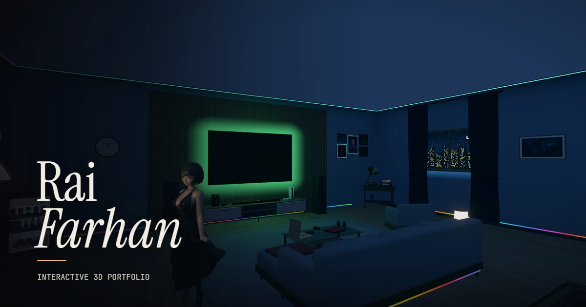

# 🌌 3D Room · Interactive Spatial Portfolio & Systems Dossier

<div align="center">

[](https://nextjs.org/)
[](https://react.dev/)
[](https://threejs.org/)
[](https://r3f.docs.pmnd.rs/)
[](https://ai.google.dev/)
[](https://www.typescriptlang.org/)
[](https://tailwindcss.com/)
[](LICENSE)

<br />

**A cutting-edge, real-time 3D spatial computing environment, virtual retro OS, and autonomous AI companion built to showcase applied AI engineering, computer vision research, and full-stack systems architecture.**

[Explore 3D Room Live](#) · [View Fast Dossier (`/quick`)](#) · [Report Issue](https://github.com/raifarhan001/3D-Portfolio/issues)

<br />



</div>

---

## 🌟 Executive Overview

**3D Room** is an immersive digital twin workstation and interactive portfolio designed by **Rai Farhan**. Instead of static resumes or generic cards, the project bridges **3D spatial WebGL rendering**, **autonomous conversational AI**, and a **fully functional virtual operating system** running inside a simulated ultrawide monitor canvas.

For recruiters, engineering leaders, and mobile visitors who need quick evaluation, the application also includes a dedicated **Systems Dossier (`/quick`)** engineered with minimalist obsidian aesthetics, interactive cursor spotlights, and project filtering.

---

## 🚀 Key Highlights & Interactive Features

### 1. 🎮 Real-Time 3D Spatial Workstation (`/`)
* **Engineered with Three.js & React Three Fiber (R3F)**: 60 FPS GPU-accelerated rendering featuring PBR materials, custom normal/roughness textures, and ambient occlusion.
* **Cinematic Post-Processing Pipeline**: Bloom, tone mapping, depth-of-field, subtle chromatic aberration, and vignette via `@react-three/postprocessing`.
* **Dynamic Day/Night Lighting Cycle**: Toggle between warm daylight sunbeams and atmospheric neon cyber night with interactive perimeter RGB wall strips.
* **Spatial Audio Engine**: 3D positional audio sources that attenuate naturally as you navigate through the virtual environment.

### 2. 🖥️ Rai XP Virtual Operating System
* **Authentic Windows XP Simulation**: Rendered onto an in-scene 21:9 ultrawide monitor using an HTML5 dynamic canvas texture.
* **Interactive Desktop Apps**:
  * `My Computer` & `Project Explorer`: Interactive folders showcasing live projects, metrics, and source links.
  * `Resume Viewer`: Formatted curriculum vitae with one-click download.
  * `Retro Snake Game`: Fully playable arcade game right inside the virtual OS desktop.
  * `Recycle Bin` & `Guestbook`: Nostalgic easter eggs and interactive system dialogs.

### 3. 🤖 Mona — Autonomous AI Robot Companion
* **Powered by Google Gemini API (`@google/genai`)**: Autonomous conversational assistant with custom memory, persona, and technical knowledge base.
* **Real-Time Voice & Speech Synthesis (`/api/robot/tts`)**: Low-latency neural speech generation and audio playback.
* **Spatial Navigation & Collision Physics**: Navigates autonomously around the room, greets the user, and answers queries regarding Rai's projects and background.

### 4. 📻 Vintage Gramophone & Heritage Cassette Deck
* **Real Vinyl Audio Player**: Features classical heritage audio tracks (`kali-kali-zulfon`, `saja-hai-maikhana`, `un-ka-andaz-e-karam`, `unki-mehfil-main`, `rafta-rafta`).
* **Procedural Web Audio Fallback**: Automated harmonic chord synthesis if physical audio assets are absent, ensuring uninterrupted audio ambiance.

### 5. 📺 Interactive Media Wall & Streaming TV
* **Dynamic CRT / Smart TV**: In-room media screen with channel switching, YouTube audio streaming `/api/tv/music`, and immersive fullscreen inspection mode.

### 6. ⚡ Systems Dossier (`/quick`)
* **Obsidian Precision Design (Linear / Vercel Grade)**: Tailored for fast review without requiring WebGL hardware acceleration.
* **Interactive Cursor Spotlight Cards**: Real-time radial cursor lighting across project and capability cards.
* **Animated Metric Counters**: Exponential ease-out counters highlighting system counts and certifications.
* **Interactive Lightbox Modal**: Verified credential previews (AWS, Anthropic, DeepLearning.AI) with direct PDF downloads.

---

## 🛠️ Technical Architecture & Stack

```
3d-portfolio/
├── src/
│   ├── app/                      # Next.js 16 App Router (SSR, SSG & Serverless APIs)
│   │   ├── api/robot/            # Gemini API conversational agent endpoint
│   │   ├── api/robot/tts/        # Neural Text-to-Speech audio streaming endpoint
│   │   ├── api/tv/music/         # Background music streaming API
│   │   ├── quick/page.tsx        # High-craft Systems Dossier page
│   │   └── page.tsx              # 3D Spatial Canvas Root
│   ├── components/               # React Three Fiber 3D meshes & UI overlays
│   │   ├── os/                   # Rai XP virtual desktop windowing system
│   │   ├── quick/                # Spotlight cards, animated counters, lightbox
│   │   ├── welcome/              # Cinematic entry title cards & sound check
│   │   ├── Room.tsx              # Room architecture, furniture, and lighting
│   │   ├── RobotCompanion.tsx    # Mona 3D rigged character & state machine
│   │   ├── GramophoneAudio.tsx   # Headless audio playback & Web Audio engine
│   │   └── TVScreen.tsx          # TV video texture & CRT shader
│   ├── config/                   # Centralized configs (OS, Robot, Room, Theme)
│   ├── stores/                   # State management powered by Zustand
│   └── utils/                    # Procedural textures, homography, sound FX
├── public/                       # 3D models (.glb), textures, audio, certificates
└── scripts/                      # Build-time prefetch scripts (GitHub repos & CV)
```

| Layer | Technology | Purpose |
| :--- | :--- | :--- |
| **Framework** | Next.js 16.4 (Turbopack) | Fast Server Components, static generation, API routes |
| **3D Engine** | Three.js + R3F + Drei | Procedural geometry, PBR lighting, camera controls |
| **Post-FX** | Postprocessing + R3F-Perf | Screen-space bloom, vignette, real-time FPS monitoring |
| **AI Brain** | Google Gemini 2.5 / 3.x | Autonomous agent prompt engineering & knowledge base |
| **State** | Zustand 5.x | Ultra-lightweight global state for TV, audio, OS, and robot |
| **Styling** | Tailwind CSS v4 | High-performance CSS engine with theme inline tokens |
| **Typography** | Inter Tight, Instrument Serif, JetBrains Mono | Refined modern editorial typographic hierarchy |

---

## 🧪 Featured Flagship Systems

| System | Focus Area | Core Stack | Description |
| :--- | :--- | :--- | :--- |
| **[Detect-Deepfakes](https://github.com/RaiFarhan0/Detect-Deepfakes-from-Facial-Blood-Flow)** | Biometric Forensics | PyTorch, OpenCV, rPPG | Detects synthetic deepfakes by extracting photoplethysmography pulse variations from facial blood flow. |
| **[VoicePulse-AI](https://github.com/RaiFarhan0/VoicePulse-AI)** | Speech Intelligence | FastAPI, Neural TTS, PyTorch | Low-latency voice platform engineered for multi-dialect conversational speech synthesis. |
| **[DocuPulse-AI](https://github.com/RaiFarhan0/DocuPulse-AI)** | Multimodal RAG | Vector Search, LLM, LangChain | Enterprise document QA pipeline powered by dense embeddings and retrieval-augmented generation. |
| **[DataPulse-AI](https://github.com/RaiFarhan0/DataPulse-AI)** | Predictive ML | Scikit-Learn, Streamlit, Pandas | Automated exploratory data analysis, dynamic feature engineering, and predictive model training. |
| **[SignAi](https://github.com/RaiFarhan0/SignAi)** | Spatial Computer Vision | MediaPipe, OpenCV, Python | Real-time sign language interpreter translating hand landmarks into natural language tokens. |

---

## 📦 Getting Started Locally

### Prerequisites
* **Node.js**: v20.x or v22.x LTS
* **npm**, **pnpm**, or **yarn**
* Modern browser with WebGL 2.0 support (Chrome, Edge, Firefox, Brave, Safari)

### 1. Clone the Repository
```bash
git clone https://github.com/raifarhan001/3D-Portfolio.git
cd 3D-Portfolio
```

### 2. Install Dependencies
```bash
npm install
```

### 3. Configure Environment Variables
Create a `.env.local` file in the root directory:
```env
# Google Gemini API Key (Required for Mona AI Assistant & Speech)
GEMINI_API_KEY=your_gemini_api_key_here

# (Optional) GitHub Token to prevent build-time API rate limits
GITHUB_TOKEN=your_github_personal_access_token_here
```

### 4. Run the Development Server
```bash
npm run dev
```

Open [http://localhost:3000](http://localhost:3000) in your browser:
* **Interactive 3D Room**: [http://localhost:3000](http://localhost:3000)
* **High-Speed Systems Dossier**: [http://localhost:3000/quick](http://localhost:3000/quick)

---

## 🚢 Deployment to Vercel

The application is optimized for **zero-configuration deployment on Vercel**:

1. Fork or push this repository to your GitHub account.
2. Sign in to [Vercel](https://vercel.com/) and click **"Add New Project"**.
3. Import your `3D-Portfolio` repository.
4. Add your **Environment Variables** in the Vercel dashboard:
   * `GEMINI_API_KEY` = `your_gemini_api_key`
   * `GITHUB_TOKEN` *(optional)* = `your_token`
5. Click **Deploy**. Vercel will automatically build the project with Turbopack and deploy to global edge CDNs with free HTTPS.

---

## ⌨️ Controls & Shortcuts

| Action | Control |
| :--- | :--- |
| **Look Around / Orbit** | Left Click + Drag / Touch Drag |
| **Pan Camera** | Right Click + Drag |
| **Zoom In / Out** | Mouse Wheel / Pinch Gesture |
| **Interact with Items** | Click on PC Screen, Gramophone, TV, Robot, Certificates |
| **Exit Active Focus** | Press `ESC` or click the Close button |
| **Day / Night Mode** | Click the Wall Light Switch |
| **Quick Dossier** | Navigate to `/quick` or press the "Quick View" button |

---

## 📜 Verified Certifications & Honors

* 🏅 **Anthropic**: Prompt Engineering & Claude Foundations
* ☁️ **Amazon Web Services (AWS)**: Generative AI & Cloud Architecture
* 🎓 **DeepLearning.AI**: Neural Networks & Deep Learning Specialization
* 🐙 **GitHub Global Honors**: Pull Shark & Pair Extraordinaire

---

## 👤 Author & Contact

**Rai Farhan**  
*Full-Stack AI Engineer & System Architect*

* 🌐 **Portfolio**: [raifarhan001.vercel.app](https://github.com/raifarhan001/3D-Portfolio)
* 💼 **LinkedIn**: [linkedin.com/in/rai-farhan](https://linkedin.com/in/rai-farhan)
* 🐙 **GitHub**: [@raifarhan001](https://github.com/raifarhan001) / [@RaiFarhan0](https://github.com/RaiFarhan0)
* ✉️ **Direct Email**: [raifarhan003@gmail.com](mailto:raifarhan003@gmail.com)
* 🚀 **Fiverr**: [fiverr.com/rai_farhan](https://www.fiverr.com/rai_farhan)

---

<div align="center">
  <sub>Built with precision, passion, and WebGL by Rai Farhan © 2026. All rights reserved.</sub>
</div>
